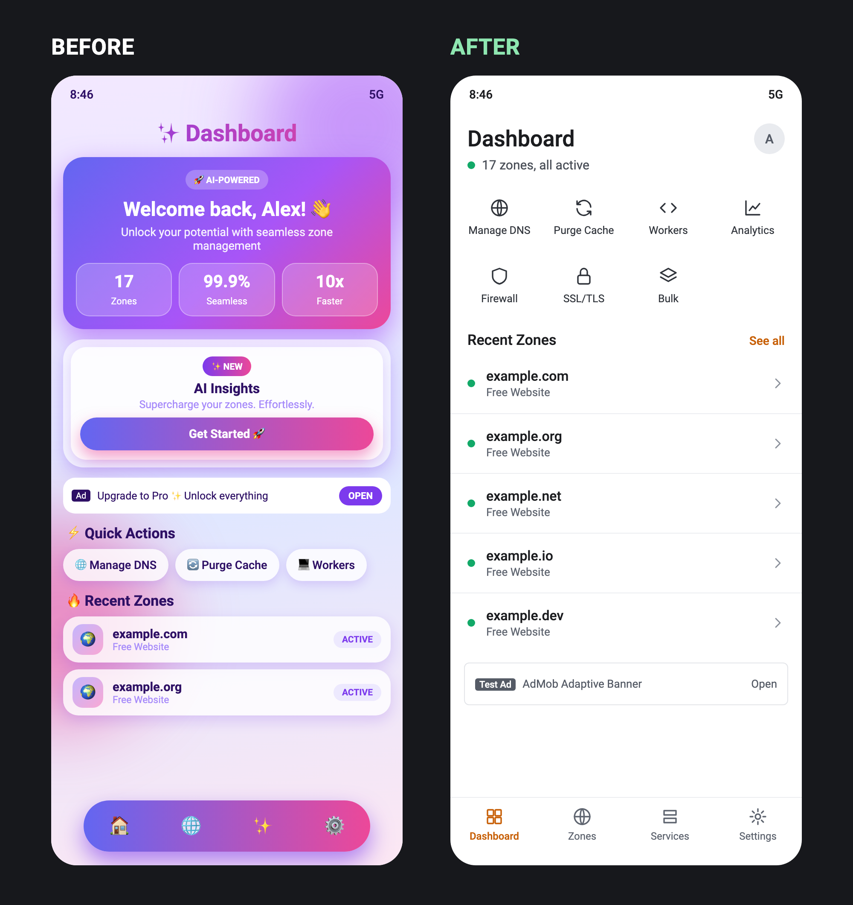

# unslopovich

**Your app looks AI-generated. Dr. Unslopovich noticed.**

Users don't hate your purple gradient. They hate what you did to the back button.



<sub>Dramatization. Your app may be worse.</sub>

```bash
npx unslopovich
```

Then tell your agent:

```text
/unslopovich review my app
```

## The doctor did the reading

Dr. Unslopovich went through 231 real app reviews and developer comments. In the 104 App Store reviews, nobody mentioned a purple gradient.

Here's what made people furious instead:

- **You moved the button.** Telegram's Contacts tab. Chrome's back arrow. Instagram's hold to pause.
- **You put AI where the feature was.** Gemini in the toolbar. Alexa in the search box.
- **You interrupted them.** Popups in the middle of ordering food.
- **You never tried it on their phone.** Clipped layouts and buttons that vanish.
- **You made everything look the same.** Gmail users can't tell read from unread.

So the doctor checks what users actually scream about first, and your gradient second.

## Symptoms

- Controls that moved, vanished, or do nothing
- AI features blocking the thing people came to do
- Website in a phone: hamburger menus, hero sections, fake tab bars
- Cards inside cards inside cards
- Emoji pretending to be icons
- Stat tiles with numbers nobody measured
- The keyboard sitting on top of the input
- "Oops! Something went wrong"
- "Unlock your potential"

## Bedside manner

> Three gradients, two hamburgers, no back button. I have questions.

> This card contains a card. That card contains a sparkle. Remove all three.

> "Seamless" is not a feature.

Sample verdicts. Yours may be worse.

## Treats

SwiftUI, UIKit, Jetpack Compose, React Native, Expo, Flutter, Ionic, and Capacitor.

It reads your theme, finds the problems, fixes the shared components first, and uses your platform's native building blocks. It won't move your users' favorite button without asking.

Only want the bad news? Ask for a review and it stops at the diagnosis.

## Other agents

Installs for Claude Code by default. For any other agent that reads `SKILL.md`, point it at that agent's skills folder:

```bash
npx unslopovich --dir ~/path/to/skills
```

## License

MIT
